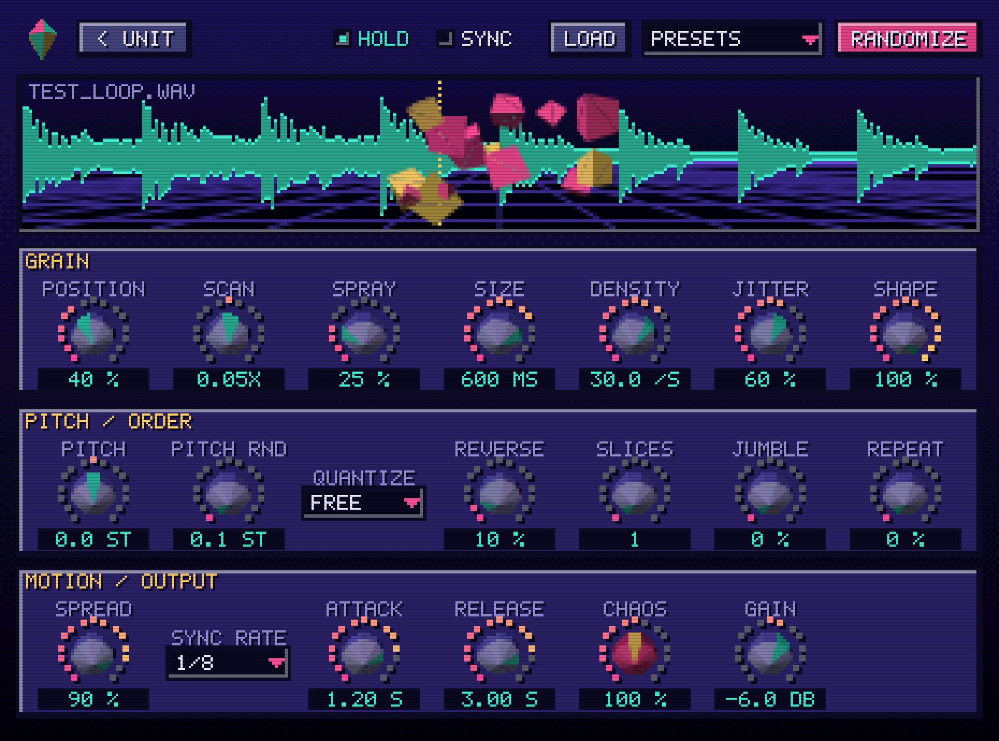

# ChaosGrain

A granular "chaos" sampler instrument (VST3 / AU / Standalone). Load a sample and it chops,
scatters, re-pitches, reverses and re-orders it into pads, glitches, stutters and chops.


The plugin opens as a compact pixel-art "grain unit" with three knobs:

- **SIZE**: grain length (short = glitch/texture, long = chops/pads)
- **CHAOS**: one knob that scales all the randomness
- **PITCH**: transpose

The red button is **HOLD** (drones the sample without MIDI), the LED flickers while grains play,
the green display counts active grains (and shows a knob's value while you turn it), and the
LED row shows density. **Click the screen or drop a file on it** to load a sample.
**Double-click** a knob to reset it.

**Right-click anywhere** for presets, randomize, tempo sync and **Advanced controls**, which opens
the full panel with every parameter:



## Using it

1. Put it on an instrument/MIDI track in your DAW.
2. Drop an audio file on the screen (or click the screen).
3. Play MIDI notes (C3 / note 60 = original pitch), or press the red **HOLD** button to drone without MIDI.
4. Right-click for presets or **Randomize** until something cool happens.

The bright blocks on the screen are the grains currently playing; the dotted line is the play position.

### All controls (Advanced panel)

### Controls

| Section | Knob | What it does |
|---|---|---|
| Grain | **Position** | Where in the sample grains start |
| | **Scan** | Moves the position through the sample (1x = normal speed, negative = backwards, 0 = frozen) |
| | **Spray** | Random offset around the position |
| | **Size** | Grain length (5 ms – 2 s). Short = textures, long = chops/pads |
| | **Density** | Grains per second |
| | **Jitter** | Timing randomness (in sync mode: chance to skip a step) |
| | **Shape** | 0 = hard-edged chop, 100 = smooth bell |
| Pitch / Order | **Pitch** | Transpose |
| | **Pitch Rnd** | Random pitch per grain (±semitones) |
| | **Quantize** | Snap the random pitch to semitones, octaves or 5ths+octaves |
| | **Reverse** | Chance a grain plays backwards |
| | **Slices** | Cuts the sample into N equal chops; grains start on slice boundaries |
| | **Jumble** | Chance a grain jumps to a random slice (shuffles the order) |
| | **Repeat** | Chance a grain repeats the last one (stutter) |
| Motion / Output | **Spread** | Random stereo panning |
| | **Sync Rate** | Grid used when **Tempo Sync** is on (follows the DAW tempo) |
| | **Attack / Release** | Note envelope |
| | **CHAOS** | Macro that scales every random amount at once (0 = tidy, 200% = madness) |
| | **Gain** | Output level |

### Recipes

- **Pads:** Size 400–1000 ms, Density 20–40, Shape 100%, Spray ~25%, slow Attack/Release. Play chords.
- **Chops:** Tempo Sync on, Rate 1/16, Slices 8–16, Jumble 50–100%, Shape low, Size ≈ one step.
- **Glitch:** Short Size (20–60 ms), high Pitch Chaos with Semitones quantize, Repeat + Reverse up.
- **Freeze:** Scan 0, Spray low, long Size, Density high – the sound freezes at Position.

## Getting a build

### Easiest: GitHub Actions
Every push builds the Windows version (VST3 + standalone `.exe`) via `.github/workflows/build.yml`.
Download it from the run's **Artifacts** section. macOS and Linux builds can be re-enabled by
uncommenting them in the workflow's build matrix.

### Build it yourself
Requires CMake 3.22+ and a C++17 compiler (Visual Studio 2022 on Windows, Xcode on macOS).
JUCE is downloaded automatically.

```bash
cmake -B build -DCMAKE_BUILD_TYPE=Release
cmake --build build --config Release
```

The plugin ends up in `build/ChaosGrain_artefacts/Release/`.

### Installing
- **Windows:** copy `ChaosGrain.vst3` to `C:\Program Files\Common Files\VST3\`
- **macOS:** copy `ChaosGrain.vst3` to `~/Library/Audio/Plug-Ins/VST3/` and `ChaosGrain.component`
  to `~/Library/Audio/Plug-Ins/Components/`. Unsigned builds downloaded from the internet may need
  `xattr -cr ~/Library/Audio/Plug-Ins/VST3/ChaosGrain.vst3` before your DAW will load them.
- **Linux:** copy `ChaosGrain.vst3` to `~/.vst3/`

Then rescan plugins in your DAW.

## Notes
- The sample's file path is saved with your project, not the audio itself; if you move the file, reload it.
- Samples are normalised on load and limited to 10 minutes.
