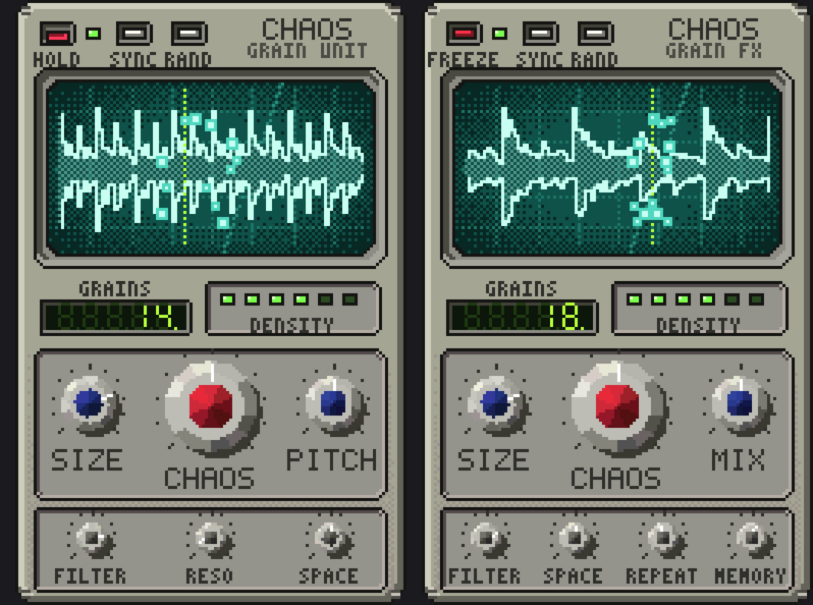

# ChaosGrain

A granular "chaos" sampler instrument (VST3 / AU / Standalone). Load a sample and it chops,
scatters, re-pitches, reverses and re-orders it into pads, glitches, stutters and chops.



Everything lives on one compact pixel-art "grain unit":

- **Three big knobs**: **SIZE** (grain length: short = glitch, long = pads/chops), **CHAOS**
  (one knob that scales all the randomness) and **PITCH** (instrument) or **MIX** (FX).
- **Small knobs** along the bottom: **FILTER · RESO · SPACE** (instrument) or
  **FILTER · SPACE · REPEAT · MEMORY** (FX).
- **Small buttons** at the top: the red **HOLD** (instrument: drone without MIDI) or **FREEZE**
  (FX), **SYNC** (lock grains to the DAW tempo; lights up when on) and **RAND** (randomize).
- The LED flickers while grains play, the green display counts active grains (and shows a knob's
  value while you turn it), and the LED row shows density.
- **Click the screen or drop a file on it** to load a sample (instrument). **Double-click** a knob to reset it.
- **Right-click** for presets.

The deeper settings below (position, spray, slices, reverse...) have no knob of their own; they are
set by the presets and RAND, and every one of them can be automated from your DAW.

## Two plugins

| | **ChaosGrain** (instrument) | **ChaosGrain FX** (effect) |
|---|---|---|
| Goes on | an instrument / MIDI track | any audio track (guitar, synth, vocals, bus) |
| Sound source | a loaded sample | the live input, recorded continuously (last ~10 s) |
| Big knobs | SIZE · CHAOS · PITCH | SIZE · CHAOS · MIX |
| Small knobs | FILTER · RESO · SPACE | FILTER · SPACE · REPEAT · MEMORY |
| Red button | HOLD (drone without MIDI) | FREEZE (stop recording, keep playing the buffer) |

- **Mix** (FX): dry/wet (equal-power). Gain only affects the wet signal, so 0% is a clean bypass.
- **Repeat** (FX): feedback. The filtered grain output is fed back into the buffer, so
  sounds smear and build up; a soft limiter in the loop keeps it stable.
- **Memory** (FX): how far back in time grains reach (0.1 to 8 s).
- **Filter / Reso**: resonant low-pass on the grains (inside the feedback loop in FX, so repeats get darker).
- **Space**: reverb.

## Using it

1. Put it on an instrument/MIDI track in your DAW.
2. Drop an audio file on the screen (or click the screen).
3. Play MIDI notes (C3 / note 60 = original pitch), or press the red **HOLD** button to drone without MIDI.
4. Right-click for presets, or hit **RAND** until something cool happens.

The bright blocks on the screen are the grains currently playing; the dotted line is the play position.

### All parameters (presets, RAND and DAW automation)

| Section | Knob | What it does |
|---|---|---|
| Grain | **Position** | Where in the sample grains start |
| | **Scan** | Moves the position through the sample (1x = normal speed, negative = backwards, 0 = frozen) |
| | **Spray** | Random offset around the position |
| | **Size** | Grain length (5 ms – 2 s). Short = textures, long = chops/pads |
| | **Density** | Grains per second |
| | **Jitter** | Timing randomness (in sync mode: chance to skip a step) |
| | **Shape** | 0 = hard-edged chop, 100 = smooth bell |
| Pitch / Order | **Pitch** | Transpose |
| | **Pitch Rnd** | Random pitch per grain (±semitones) |
| | **Quantize** | Snap the random pitch to semitones, octaves or 5ths+octaves |
| | **Reverse** | Chance a grain plays backwards |
| | **Slices** | Cuts the sample into N equal chops; grains start on slice boundaries |
| | **Jumble** | Chance a grain jumps to a random slice (shuffles the order) |
| | **Repeat** | Chance a grain repeats the last one (stutter) |
| Motion / Output | **Spread** | Random stereo panning |
| | **Sync Rate** | Grid used when **Tempo Sync** is on (follows the DAW tempo) |
| | **Attack / Release** | Note envelope |
| | **CHAOS** | Macro that scales every random amount at once (0 = tidy, 200% = madness) |
| | **Gain** | Output level |

### Recipes

- **Pads:** Size 400–1000 ms, Density 20–40, Shape 100%, Spray ~25%, slow Attack/Release. Play chords.
- **Chops:** Tempo Sync on, Rate 1/16, Slices 8–16, Jumble 50–100%, Shape low, Size ≈ one step.
- **Glitch:** Short Size (20–60 ms), high Pitch Chaos with Semitones quantize, Repeat + Reverse up.
- **Freeze:** Scan 0, Spray low, long Size, Density high – the sound freezes at Position.

## Getting a build

### Easiest: GitHub Actions
Every push builds the Windows version (VST3 + standalone `.exe`) via `.github/workflows/build.yml`.
Download it from the run's **Artifacts** section. macOS and Linux builds can be re-enabled by
uncommenting them in the workflow's build matrix.

### Build it yourself
Requires CMake 3.22+ and a C++17 compiler (Visual Studio 2022 on Windows, Xcode on macOS).
JUCE is downloaded automatically.

```bash
cmake -B build -DCMAKE_BUILD_TYPE=Release
cmake --build build --config Release
```

The plugin ends up in `build/ChaosGrain_artefacts/Release/`.

### Installing
- **Windows:** copy `ChaosGrain.vst3` and `ChaosGrain FX.vst3` to `C:\Program Files\Common Files\VST3\`.
  The standalone apps are `ChaosGrain.exe` and `ChaosGrain FX.exe` (the FX one uses your audio
  interface input: pick it under Options > Audio/MIDI Settings and use headphones to avoid feedback).
- **macOS:** copy `ChaosGrain.vst3` to `~/Library/Audio/Plug-Ins/VST3/` and `ChaosGrain.component`
  to `~/Library/Audio/Plug-Ins/Components/`. Unsigned builds downloaded from the internet may need
  `xattr -cr ~/Library/Audio/Plug-Ins/VST3/ChaosGrain.vst3` before your DAW will load them.
- **Linux:** copy `ChaosGrain.vst3` to `~/.vst3/`

Then rescan plugins in your DAW.

## Notes
- The sample's file path is saved with your project, not the audio itself; if you move the file, reload it.
- Samples are normalised on load and limited to 10 minutes.
